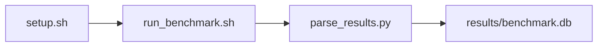

# System Config Verification Benchmark

[](LICENSE)
[](.github/workflows/ci.yml)

Target: Ubuntu 26.04 · AMD · see Hardware Requirements. This is a host benchmark, not a laptop `pip install` project.

## Quick Start

```bash
git clone https://github.com/garys-gpu-benchmarks/301-sys-bench-amd-rocm-stack-validation-ubu2604.git
cd 301-sys-bench-amd-rocm-stack-validation-ubu2604
sudo bash setup.sh --assume-yes
bash run_benchmark.sh --profile smoke --validate
```
Results are written to `results/benchmark.db` and `results/summary.json`.

This workload is executed on the validation host after the repository is copied there. `setup.sh` and `run_benchmark.sh` do not open an outbound SSH session.

Prerequisites: Ubuntu 26.04; AMD; Python 3.14.4; root or sudo for `setup.sh`. Framework: Bash, SQLite, Python, PyYAML, ROCm, rocminfo, rocm-smi, amd-smi, HIP/hipcc, RVS. This is a host benchmark, not a laptop `pip install` project.



## 1. Overview

Runs seven ROCm stack probes and emits one CSV row per tool. kernel_version: expected uname -r prefix, published as the kernel mismatch count. driver_version: compared with the amdgpu modinfo version field for driver compliance. When that field is absent, driver compliance is na (in-tree amdgpu has no version). Sweep dimensions: kernel_version, driver_version, rocm_version, required_packages, permissions_check, output_format.

## 2. What It Validates

- Validates ROCm tool presence, kernel release match, driver compliance when amdgpu has a version, package presence, and GPU device-node permissions. Does not run DCGM
- #1: ROCm package mismatch count (rocm_package_mismatch_count); is present and physically sensible.
- #2: Kernel mismatch count (kernel_driver_mismatch_count); is present and physically sensible.
- #3: Driver compliance percent (driver_compliance_percent); is present and physically sensible.
- #4: Permission error count (permission_error_count) is present and physically sensible.

## 3. Metrics Captured

- **#1: ROCm package mismatch count** — stored as `rocm_package_mismatch_count`.
- **#2: Kernel mismatch count** — stored as `kernel_driver_mismatch_count`.
- **#3: Driver compliance percent** — stored as `driver_compliance_percent`.
- **#4: Permission error count** — stored as `permission_error_count`.

## 4. Hardware Requirements

### Supported environment

- OS: Ubuntu 26.04
- GPU vendor: AMD
- Framework family: Bash, SQLite, Python, PyYAML, ROCm, rocminfo, rocm-smi, amd-smi, HIP/hipcc, RVS
- Python: Python 3.14.4

### Reference validation environment

The tables below describe the machine used to generate the reference results. They are not a requirement that every user buy that exact cloud instance.

### System

Ubuntu 26.04 / AMD / Bash, SQLite, Python, PyYAML, ROCm, rocminfo, rocm-smi, amd-smi, HIP/hipcc, RVS

### GPU

Ubuntu 26.04 / AMD / Bash, SQLite, Python, PyYAML, ROCm, rocminfo, rocm-smi, amd-smi, HIP/hipcc, RVS

## 5. Software Requirements

| Component | Version |
|---|---|
| OS | Ubuntu 26.04 |
| Kernel | kernel 7.0.0 |
| Python | Python 3.14.4 |
| ROCm | ROCm 7.14 |
| rocBLAS | N/A - rocBLAS not used |

Runs seven ROCm stack probes and emits one CSV row per tool. kernel_version: expected uname -r prefix, published as the kernel mismatch count. driver_version: compared with the amdgpu modinfo version field for driver compliance.

## 6. Installation

```bash
Run rvs --version, rocminfo, rocm-smi, amd-smi static, uname -a, modinfo amdgpu, hipcc --version, and dpkg-query
```

## 7. Running the Benchmark

```bash
Run rvs --version, rocminfo, rocm-smi, amd-smi static, uname -a, modinfo amdgpu, hipcc --version, and dpkg-query
```

**Validating results separately:**

```bash
export BENCHMARK_PYTHON=/usr/bin/python3.13  # optional
python3 -m venv .venv
source ".venv/bin/activate"
".venv/bin/python" scripts/validate_results.py
```

## 8. Output

### `results/benchmark.db` (SQLite)

CSV with one row per tool probe, plus a transcript per command (rvs.txt, rocminfo.txt, rocm-smi.txt, amd-smi.txt, uname.txt, modinfo.txt, hipcc.txt)

sample_index,check_name,rocm_package_mismatch_count,kernel_driver_mismatch_count,kernel_mismatch_count,driver_mismatch_count,driver_version_available,driver_compliance_percent,permission_error_count
0,rocminfo,0,0,0,0,1,100,0

```bash
Run rvs --version, rocminfo, rocm-smi, amd-smi static, uname -a, modinfo amdgpu, hipcc --version, and dpkg-query
```

### `results/summary.json`

Consolidated metrics from the most recent run — suitable for CI artifact upload or dashboard ingestion.

### `results/raw/<timestamp>.txt`

CSV with one row per tool probe, plus a transcript per command (rvs.txt, rocminfo.txt, rocm-smi.txt, amd-smi.txt, uname.txt, modinfo.txt, hipcc.txt)

sample_index,check_name,rocm_package_mismatch_count,kernel_driver_mismatch_count,kernel_mismatch_count,driver_mismatch_count,driver_version_available,driver_compliance_percent,permission_error_count
0,rocminfo,0,0,0,0,1,100,0

## 9. Baselines / Thresholds

Expected ranges and gates live in `config/benchmark_config.yaml` under `baselines:` or `thresholds:`. To update them, edit that file — never edit validation code directly.

## 10. Troubleshooting

**`setup.sh` missing collector**
Create cannot finish without `scripts/collect_workload.py`.

**`self_check` overlay rewritten**
Do not overwrite files listed in `results/overlay_lock.json`.

**Remote SSH drop during setup**
Reconnect and resume `bash setup.sh --assume-yes`. Do not wipe `.venv` or `.cache`.

## 11. NVIDIA H100 Coding Differences

Primary target is AMD ROCm. NVIDIA notes in this section are reference only and are not the execution path.

## Repository layout

```text
.
├── setup.sh
├── run_benchmark.sh
├── benchmark_specification.json
├── config/
├── scripts/
├── src/
├── tests/
├── docs/
├── results/
└── LICENSE
```
